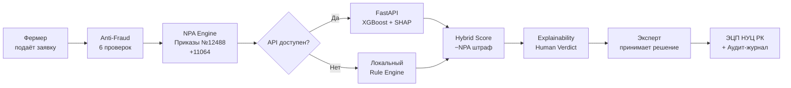

# 🌾 АгроСкоринг КЗ 4.0 — Интеллектуальная экосистема субсидирования

> **Хакатон:** Decentrathon 5.0 · Трек «AI for Government» · Кейс 2: Скоринг субсидий  
> **Этап 3:** Финальный прототип · AI for Government · Минсельхоз РК

[](https://python.org)
[](https://fastapi.tiangolo.com)
[](https://xgboost.readthedocs.io)
[](https://shap.readthedocs.io)
[]()
[]()

---

## Проблема

Казахстан распределяет сельхозсубсидии по принципу **«кто первый успел»** вместо **«кто заслуживает»**. Это порождает:

- Очереди без приоритизации: высокоэффективные хозяйства конкурируют с дебютантами наравне
- Непрозрачность: эксперт не может объяснить, почему отклонена конкретная заявка
- Риск нарушений НПА: фермеры с перегруженными пастбищами или высоким падежом получают субсидии наравне с добросовестными
- Отсутствие аудиторского следа: невозможно доказать объективность решения постфактум

---

## Решение

**АгроСкоринг КЗ 4.0** — полная экосистема merit-скоринга для субсидий в сельском хозяйстве Казахстана. Система присваивает каждой заявке балл **0–100**, проверяет соответствие **Приказам МСХ РК**, объясняет каждое решение и фиксирует его с **ЭЦП** в аудит-журнале.

> **Ключевой принцип:** ИИ не заменяет чиновника — он делает его работу прозрачной, обоснованной и защищённой от коррупционного давления.

---

## Архитектура системы

```
┌─────────────────────────────────────────────────────────────────────┐
│                    УРОВЕНЬ ПРЕДСТАВЛЕНИЯ (Frontend)                  │
│                                                                     │
│  ┌─────────────┐  ┌─────────────┐  ┌─────────────┐  ┌───────────┐  │
│  │  Фермер     │  │  Эксперт    │  │  Шортлист   │  │  Печать   │  │
│  │  (подача)   │  │  (решение)  │  │  Дашборд    │  │  отчёта   │  │
│  └─────────────┘  └─────────────┘  └─────────────┘  └───────────┘  │
│                  Vanilla JS · Single HTML File · No Build            │
└──────────────────────────────┬──────────────────────────────────────┘
                               │ POST /score (JSON)
                               ▼
┌─────────────────────────────────────────────────────────────────────┐
│                       УРОВЕНЬ API (FastAPI)                          │
│            /score  /train  /health  /audit                          │
└────────────────────────┬─────────────────────────────────────────────┘
          ┌──────────────┼──────────────┐
          ▼              ▼              ▼
┌──────────────┐  ┌─────────────┐  ┌───────────────────────────────┐
│  Rule Engine │  │  XGBoost    │  │  NPA Compliance Engine        │
│  5 блоков    │  │  Classifier │  │  Приказ МСХ РК №12488         │
│  (всегда     │  │  + SHAP     │  │  Приказ МСХ РК №11064         │
│  работает)   │  │  (если      │  │  Региональные нормы пастбищ   │
│              │  │  обучен)    │  │  ИСЖ/ИАС                      │
└──────────────┘  └─────────────┘  └───────────────────────────────┘
          │              │                       │
          └──────────────┴───────────────────────┘
                               │
                        Hybrid Score = 0.4×Rules + 0.6×ML − NPA_Penalty
                               │
                               ▼
┌─────────────────────────────────────────────────────────────────────┐
│                     УРОВЕНЬ РЕШЕНИЯ ЭКСПЕРТА                         │
│   Скоринг → Human Verdict → SHAP-объяснение → ЭЦП НУЦ РК          │
│                          ↓                                          │
│                    Аудит-журнал (JSONL / Blockchain-ready)          │
└─────────────────────────────────────────────────────────────────────┘
```



---

## Методология скоринга

| Блок | Макс. баллов | Ключевые сигналы |
|---|---|---|
| Финансовая состоятельность | 25 | Выручка, кредитный рейтинг, налоговый статус, кредитная история |
| Производственный потенциал | 20 | Площадь, культуры, орошение, техника, приоритетные виды |
| Надёжность и история | 20 | Лет в бизнесе, история субсидий, форма собственности |
| Документы и соответствие | 20 | Полнота пакета, налоговая чистота, история нарушений |
| Социально-экономический эффект | 15 | Занятость, диверсификация, приоритетный регион |
| **Итого** | **100** | |
| **НПА-штраф** | **−до 75** | Нарушения Приказов №12488 и №11064 |

**Итоговый балл** = max(0, Rule Score × 0.4 + ML Score × 0.6 − NPA Penalty)

---

## Compliance — НПА МСХ РК

Система автоматически проверяет каждую заявку по двум нормативным актам:

### Приказ МСХ РК №12488 — Нормы естественной убыли скота

| Параметр | Норма | Штраф при нарушении |
|---|---|---|
| Максимальный уровень падежа | ≤ 2.5% от поголовья в год | −35 баллов |

**Логика:** `mortality_rate = dead_animals / total_livestock`  
Если `mortality_rate > 0.025` → выводится красный алерт с нормой и фактическим значением, −35 к итоговому баллу.

### Приказ МСХ РК №11064 — Нормы нагрузки на пастбища (региональные)

| Климатическая зона | Регионы | Норма (гол./га) | Штраф |
|---|---|---|---|
| Аридная (пустынь) | Мангистауская, Атырауская, Кызылординская, Туркестанская | ≤ 0.08 | −30 баллов |
| Горно-степная | ВКО, Алматинская, Жетысуская, Абайская | ≤ 0.12 | −30 баллов |
| Степная (север) | Костанайская, СКО, Акмолинская, Павлодарская, ЗКО | ≤ 0.20 | −30 баллов |
| Прочие | — | ≤ 0.15 | −30 баллов |

**Логика:** `pasture_load = total_livestock / pasture_hectares`  
Норма берётся из региона заявителя автоматически при выборе области.

### ИСЖ/ИАС — Регистрация хозяйства

Отсутствие регистрации в системе идентификации животных — дополнительный штраф −10 баллов (обязательное условие субсидирования животноводства).

---

## Функционал v4.0 — Новые возможности

### 1. Расширенный каталог культур и животных (Локализация РК)

**Растениеводство** разбито на 6 групп: зерновые (пшеница яровая/озимая, ячмень, овёс, кукуруза на зерно, рис Кызылорды, просо), масличные (подсолнечник, рапс, лён, соя, сафлор), технические (хлопок Туркестанской обл., сахарная свёкла Жетысу), бобовые (нут, чечевица, горох), кормовые (люцерна, кукуруза на силос), овощи.

**Животноводство** разбито на 5 групп: КРС мясное (Ангус/Герефорд) и молочное, мелкий скот (овцы, козы), коневодство (мясное и племенное), экзотика РК (верблюды-бактрианы, верблюды-дромедары, маралы ВКО), птицеводство (бройлеры, несушки, индейка).

### 2. Региональный контекст в НПА-проверках

При выборе области заявителем норма нагрузки на пастбища автоматически корректируется: аридные зоны — строже (0.08 гол./га), степные — мягче (0.20 гол./га). Региональная норма отображается прямо на форме и в отчёте.

### 3. Живой шортлист с генерацией демо-данных

Кнопка **«🔀 Сгенерировать демо-данные»** создаёт 10 случайных заявок с разными баллами, регионами и НПА-статусами. Новая колонка **«Приоритет»**: хозяйства с племенным животноводством или экспортными культурами (лён, хлопок, соя, сафлор) получают метку **⭐ Высокий** — они рассматриваются первыми.

### 4. Печать официального заключения

Кнопка **«🖨 Печать заключения»** формирует строгий официальный отчёт через `window.print()`. CSS `@media print` скрывает все интерфейсные элементы (навигацию, кнопки, фильтры) и оставляет: ФИО заявителя, балл ИИ, НПА-статус с нормами Приказов №12488 и №11064, рекомендацию, дату. Готов к подшиванию в дело.

### 5. Ролевая модель (Human-in-the-Loop)

**Режим Фермера** — форма + просмотр статуса. Панель решений скрыта.  
**Режим Эксперта** — полный доступ: скоринг + НПА + панель «Одобрить / На доработку / Отклонить» + ЭЦП.

### 6. Симуляция ЭЦП (НУЦ РК)

Подписание решения через modal-окно с сертификатом, полем пароля и статусом НПА. После подтверждения — запись в аудит-журнал с TX-hash.

### 7. Аудит-журнал

JSON-объект с полными данными решения (балл модели, решение эксперта, НПА-проверки, региональная норма, Приказы МСХ РК) выводится на экран и в `console.log`. В продакшене — синхронизируется с блокчейн-узлом.

---

## Быстрый запуск — пошаговая инструкция

### Требования

- Python 3.9 или выше
- Современный браузер (Chrome, Edge, Firefox, Safari)
- Интернет (только для Google Fonts и загрузки стартовых данных)

---

### 🪟 Windows — пошагово

```bat
:: Шаг 0: Убедитесь, что Python установлен
python --version
:: Если ошибка — установите Python с https://python.org
:: При установке поставьте галочку «Add Python to PATH»

:: Шаг 1: Откройте папку проекта в терминале
:: Зажмите Shift + правая кнопка мыши → «Открыть окно PowerShell»

:: Шаг 2: Создайте виртуальное окружение
python -m venv venv
venv\Scripts\activate

:: Шаг 3: Установите зависимости
python -m pip install -r backend\requirements.txt

:: Шаг 4: Запустите бэкенд
cd backend
uvicorn main:app --reload --port 8000

:: Шаг 5: Откройте фронтенд
:: Дважды кликните на frontend\index.html — откроется в браузере
:: В шапке загорится 🟢 API онлайн
```

**Если порт 8000 занят:**
```bat
uvicorn main:app --reload --port 8001
```
Затем в `frontend/index.html` измените строку `const API_BASE = 'http://localhost:8000'` на `...:8001`.

---

### 🍎 macOS

```bash
# Шаг 1: Установите Python (если нет)
brew install python3    # или с https://python.org

# Шаг 2: Создайте виртуальное окружение
python3 -m venv venv
source venv/bin/activate

# Шаг 3: Установите зависимости
pip install -r backend/requirements.txt

# Шаг 4: Запустите бэкенд
cd backend
uvicorn main:app --reload --port 8000

# Шаг 5: Откройте фронтенд
open frontend/index.html
```

---

### 🐧 Linux (Ubuntu / Debian)

```bash
# Шаг 1: Установите Python (если нет)
sudo apt update && sudo apt install python3 python3-pip python3-venv -y

# Шаг 2: Создайте виртуальное окружение
python3 -m venv venv
source venv/bin/activate

# Шаг 3: Установите зависимости
pip install -r backend/requirements.txt

# Шаг 4: Запустите бэкенд
cd backend
uvicorn main:app --reload --port 8000

# Шаг 5: Откройте фронтенд
xdg-open frontend/index.html  # или откройте вручную в браузере
```

---

### Работа без бэкенда (режим офлайн)

Просто откройте `frontend/index.html` в браузере. Система автоматически переключится на встроенный детерминированный движок — все функции (НПА, шортлист, ЭЦП, печать) работают без сервера.

---

### Обучение модели на реальных данных

```bash
# Если есть CSV-файл с данными хакатона:
curl -X POST http://localhost:8000/train \
  -F "file=@ваш_датасет.csv"

# Без файла — обучение на встроенных синтетических данных:
python backend/ml_engine.py
```

Документация Swagger: **http://localhost:8000/docs**

---

## Структура репозитория

```
agroskoring-kz/
├── backend/
│   ├── main.py            # FastAPI: /score, /train, /health
│   ├── ml_engine.py       # Rule Engine + XGBoost + SHAP + NPA Engine
│   └── requirements.txt   # Python-зависимости
├── frontend/
│   └── index.html         # Весь фронтенд — один файл, без сборки
├── data/
│   └── mock_dataset.csv   # 500 синтетических заявок
└── README.md
```

---

## API-справка

### `POST /score` — оценить заявку

```json
{
  "iin": "120540001234",
  "name": "ИП «Жайлау»",
  "revenue_k_tenge": 45000,
  "hectares": 250,
  "years_operating": 6,
  "credit_score": 72,
  "num_employees": 12,
  "equipment_value_m": 65,
  "num_crops": 3,
  "num_livestock_types": 1,
  "has_irrigation": 1,
  "owns_land": 1,
  "certified_seeds": 1,
  "tax_status_enc": 0,
  "subsidy_history_enc": 2,
  "loan_history_enc": 0,
  "num_documents": 5,
  "oblast_priority": 1,
  "total_livestock": 80,
  "dead_animals_year": 2,
  "pasture_hectares": 600,
  "has_ias_registration": 1
}
```

```json
{
  "score": 78,
  "verdict": "approve",
  "engine_used": "hybrid (rules 40% + XGBoost 60%)",
  "npa_result": {
    "all_passed": true,
    "penalties_total": 0,
    "violations": [],
    "summary_ru": "Все параметры соответствуют нормативам МСХ РК."
  },
  "shap_factors": [
    {"name": "история субсидий", "impact": 31.2},
    {"name": "годовая выручка",  "impact": 19.8}
  ],
  "explanation": "ИП «Жайлау» соответствует критериям одобрения..."
}
```

### `GET /health`

```json
{
  "status": "ok",
  "model_trained": true,
  "version": "4.0.0",
  "npa_constants": {
    "max_mortality_rate_pct": 2.5,
    "orders_checked": ["Приказ МСХ РК №12488", "Приказ МСХ РК №11064"]
  }
}
```

---

## Explainability — почему это не «чёрный ящик»

Система даёт объяснение на **трёх уровнях** одновременно:

1. **SHAP-факторы** — прогресс-бары с числовым вкладом каждого признака (+/-). Эксперт видит точно, что повлияло на балл.
2. **НПА-протокол** — отдельный блок с нормами Приказов №12488 и №11064, фактическими значениями и суммой штрафа. Каждое нарушение сопровождается ссылкой на нормативный акт.
3. **Human-Readable Verdict** — текстовое резюме: «Главный положительный фактор — X (+N пунктов). Главный риск — Y (−M пунктов). Балл 71 из 100 превышает порог одобрения.»

---

## Известные ограничения

| Ограничение | Статус |
|---|---|
| ЭЦП — симуляция | Интеграция с НУЦ РК потребует KalkanCrypt SDK |
| Данные реестров (Qoldau, ЦКН) | Не интегрированы — фермер вводит вручную |
| Концептуальный дрейф модели | Требует переобучения перед каждым субсидийным сезоном |
| Конфиденциальность (ИИН) | В продакшене — только хэш заявки в аудит-журнале |
| Нагрузочное тестирование | Не проводилось — прототип |

---

## Команда

Decentrathon 5.0 · Трек AI for Government · Финальный этап
